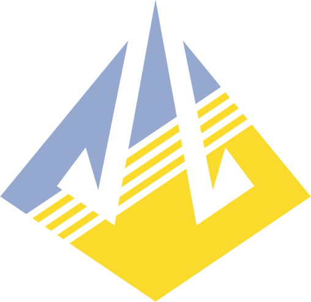

# Marvel Rivals Info (마블 라이벌즈 영웅 스킬 도감)

<p align="center">
  
</p>

> 마블 라이벌즈(Marvel Rivals) 전체 영웅(57명, 역할별 데드풀 포함)의 정밀 스킬 수치, 폼별 베이스 스탯(HP, SPD), 최신 팀업(Team-Up) 로드아웃(Base / Enhanced) 정보를 한국어(KR), 일본어(JP), 영어(EN)로 제공하는 경량 웹 도감입니다.

---

## ✨ 주요 기능 (Features)

- 🌐 **완벽한 3개 국어 지원 (Multi-Language Support)**
  - 한국어(KR), 日本語(JP), English(EN) 실시간 원클릭 전환
  - 영웅 이름, 역할군, 멀티 폼 명칭, 스킬/팀업 설명, 스탯 라벨 및 세부 수치 100% 다국어 지원
  - 밸런스 패치로 숫자만 변경되거나 신규 영웅이 출시될 때 동적 패턴 치환 및 영어 안전 폴백 지원
- 📊 **정밀한 스킬 수치 & 하위 섹션 표기 (Accurate Stats & Sub-Sections)**
  - 영웅 및 멀티 폼(헐크, 블랙 캣, 매직, 클록 & 대거, 갬빗, 화이트 폭스) 실시간 체력(HP) 및 이동 속도(SPD) 동기화
  - 다단계/복합 스킬(예: 스파이더맨 주먹/발차기, 더 퍼니셔 개틀링 건/어깨 미사일 등)의 섹션별 독립 수치 완벽 보존
- ⚡ **데드풀 역할군 분리 & 스킬 업그레이드(⭐) 토글**
  - 데드풀의 3개 역할군(뱅가드, 듀얼리스트, 전략가) 독립 분리 및 공식 스탯 자동 반영
  - 스킬 헤더의 별 토글 버튼으로 기본 효과 ↔ 업그레이드 수치 즉시 전환
- 🤝 **최신 팀업 로드아웃 비교 (Base vs Enhanced)**
  - 솔로 기본 효과(Base)와 파트너 시너지 강화 효과(Enhanced) 2단 비교 및 파트너 초상화/이름 표시
- 🔗 **직링크 공유 & 모바일 친화 UX**
  - 영웅 모달 오픈 시 URL 해시(`#hero=...`) 자동 연동 및 모바일 브라우저 뒤로가기로 모달 닫기 지원
  - 키보드 단축키(`/` 검색 포커스, `Esc` 닫기, 모달 포커스 트랩) 및 이벤트 위임 기반 고속 렌더링
- 🤖 **공홈 데이터 자동 동기화 (GitHub Actions CI/CD)**
  - 매일 한국 시간 오전 9시에 공식 홈페이지 데이터를 파싱하고 번역·스키마·이미지 무결성 검증 통과 시 자동 배포합니다.

---

## 📁 프로젝트 구조 (Project Structure)

```text
MarvelRivals_info/
├── .github/workflows/
│   └── auto_sync.yml              # 공홈 패치 자동 감지 및 무결성 검증·배포 워크플로우
├── assets/
│   ├── ignite_icon.png            # 마블 라이벌즈 Ignite 아이콘 (파비콘 및 헤더)
│   ├── liquipedia.png             # 개발자 모달 Liquipedia 아이콘
│   └── icons/                     # 역할군 아이콘 (role_vanguard, role_duelist, role_strategist)
├── data/
│   ├── heroes.json                # 57명 전체 영웅의 스킬, 멀티 폼, 팀업 통합 데이터
│   ├── i18n.json                  # 다국어 UI 텍스트 사전 (KO, JA, EN)
│   ├── translations.json          # 경량 런타임 스탯 번역 번들 (자동 생성)
│   └── translations/              # 번역 원본 사전 (skills.json, teamups.json, stats.json)
├── scripts/
│   ├── sync_heroes.py             # 공식 웹사이트 실시간 파싱 및 데이터 동기화
│   ├── post_process.js            # 데드풀 분리, 멀티 폼 구성, 번역 주입 및 캐시 해시 갱신
│   ├── build_unified_translations.py # stats.json → 경량 data/translations.json 컴파일러
│   ├── validate_translations.js   # 다국어 순수도 및 번역 커버리지 검증
│   ├── validate_heroes.py         # 영웅 스키마 및 기본 스탯 무결성 검증
│   ├── test_integration.js        # HTML/JS/JSON 프론트엔드 통합 테스트
│   └── check_images.py            # 공식 이미지 URL 유효성 검사
├── index.html                     # 메인 웹 페이지
├── app.js                         # 프론트엔드 애플리케이션 로직
├── styles.css                     # 다크 백과사전 테마 스타일시트
└── README.md
```

---

## 🚀 실행 방법 (Getting Started)

별도의 백엔드나 외부 패키지 설치 없이 정적 웹 서버만으로 즉시 실행됩니다.

### 1. 로컬 웹 서버 실행
```bash
python3 -m http.server 3000
```
브라우저에서 `http://localhost:3000` 접속 (또는 `npx serve .`)

### 2. 수동 데이터 최신화 및 검증 파이프라인
```bash
# 1) 공홈 최신 데이터 크롤링
python3 scripts/sync_heroes.py

# 2) 데드풀 분리, 멀티 폼 구성, 번역 주입 및 캐시 해시 동기화
node scripts/post_process.js

# 3) 경량 스탯 번역 번들 빌드
python3 scripts/build_unified_translations.py

# 4) 무결성 및 통합 검증
node scripts/validate_translations.js
python3 scripts/validate_heroes.py
node scripts/test_integration.js
```

---

## 📄 라이선스 (License)

본 프로젝트는 팬메이드 비공식 프로젝트이며, 마블 라이벌즈와 관련된 모든 캐릭터, 이미지 및 상표의 권리는 Marvel 및 NetEase Games에 있습니다.
